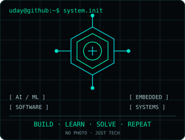
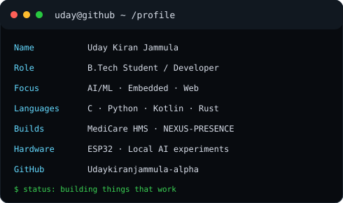

<div align="center">

# `uday@github:~$ whoami`

### UDAY KIRAN JAMMULA
`B.Tech student` · `AI/ML` · `embedded systems` · `software development`



<sub>Self-hosted public contribution calendar · refreshed daily · no external stats services</sub>

</div>

<br>

<table><tr><td valign="top" width="43%"></td><td valign="top" width="57%"></td></tr></table>

## `./focus`

Building practical systems across AI/ML, embedded hardware, web development, software development, and local AI. I work with `C`, `Python`, `Kotlin`, `Rust`, `Git`, `Linux`, `HTML`, `CSS`, `JavaScript`, `Docker`, `ESP32`, `STM32`, `Electron`, and `SQLite`.

## `./selected-projects`

| Project | What it explores |
| --- | --- |
| [MediCare Hospital Management System](https://github.com/Udaykiranjammula-alpha/hospital-management-system) | Hospital-management workflow, with a [live demo](https://hospital-management-system-msz2.vercel.app/). |
| [NEXUS-PRESENCE](https://github.com/Udaykiranjammula-alpha/NEXUS-PRESENCE) | Multi-node ambient Wi-Fi human-presence and movement visualization. |
| [ESP32 Distributed ML Accelerator](https://github.com/Udaykiranjammula-alpha/esp32-distributed-ml-accelerator) | Two-node master/worker experiment for distributed ML inference on ESP32. |
| [Uday AI Local Server](https://github.com/Udaykiranjammula-alpha/uday-ai-local-server) | Local-first AI server exploration. |
| `LUKE / SRI AI` | AI assistant development work; no public repository link is claimed here. |

## `./benchmarks --source project`

`ESP32 Distributed ML Accelerator` reports these project measurements: single ESP32 `22 µs`; master layer 1 `9 µs`; worker layer 1 `13 µs`; output layer `4 µs`; communication + worker `3754 µs`. These are project-reported values and have not been independently verified.

## `./status`

```text
[ready] learn deeply
[ready] build useful things
[ready] explore local-first and embedded AI
```

<div align="center">

[`github.com/Udaykiranjammula-alpha`](https://github.com/Udaykiranjammula-alpha) · [`setup and maintenance`](./SETUP.md)

</div>
